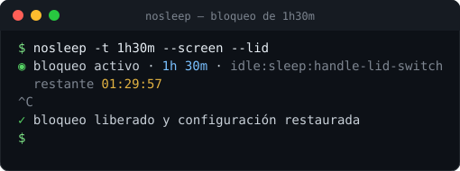
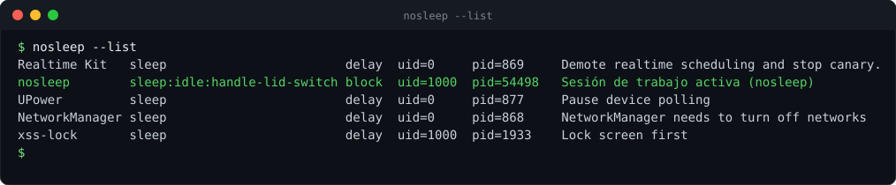

<div align="center">

# nosleep

**Mantén tu laptop Linux despierta. Sin dejar basura.**

Una pequeña CLI en Rust que mantiene un bloqueo de `systemd-logind` el tiempo que necesites
y, si quieres, mantiene la pantalla encendida e ignora el cierre de la tapa.

Español · [English](README.md)



</div>

## Por qué

`systemd-inhibit sleep 3600` funciona, pero no muestra cuenta regresiva, no evita que una
pantalla X11 se apague y no puede devolver tu configuración de pantalla si algo sale mal.
`nosleep` hace las tres cosas:

- **Inhibidor de logind sujeto a un descriptor de archivo.** Cuando el proceso termina,
  incluso con `SIGKILL`, el kernel cierra el fd y logind suelta el bloqueo. No queda nada colgado.
- **Pantalla encendida (`--screen`).** Desactiva el salvapantallas y DPMS de X11 con `xset`
  y, al salir, devuelve exactamente los valores que tenías.
- **Restauración a prueba de caídas.** Tu configuración original de `xset` se guarda en disco
  *antes* de cambiar nada. Si matan el proceso a la fuerza, `nosleep --restore` la recupera.
- **Atado a un comando (`--while`).** Mantiene el equipo despierto solo mientras corre una
  compilación, un backup o una descarga, y devuelve el código de salida de ese comando.

## Instalación

Necesitas Linux con **systemd-logind** y **Rust 1.88+**.
`--screen` además necesita una sesión **X11** y `xset` (`sudo dnf install xset` / `sudo apt install x11-xserver-utils`).

```sh
cargo install --git https://github.com/AngheloBR/nosleep-tui
```

O desde un clon:

```sh
git clone https://github.com/AngheloBR/nosleep-tui
cd nosleep-tui
cargo install --path .
```

## Uso

```sh
nosleep                         # bloquea la suspensión 1 hora (por defecto)
nosleep -t 1h30m                # duración personalizada
nosleep -t inf                  # hasta que pulses Ctrl+C
nosleep -t 8h --screen --lid    # pantalla encendida, cerrar la tapa no suspende
nosleep --while cargo build --release   # solo mientras corre el comando
nosleep --list                  # muestra todos los inhibidores activos
nosleep --restore               # repara la pantalla tras una muerte forzada
```

Pulsa **Ctrl+C** cuando quieras: se suelta el bloqueo y se restaura la pantalla.



### Duraciones

| Entrada           | Significado                    |
| ----------------- | ------------------------------ |
| `45s` `90m` `2h`  | segundos, minutos, horas       |
| `1d`              | días (máximo `365d`)           |
| `1h30m`           | combinadas                     |
| `90`              | número solo = minutos          |
| `1.5h` / `1,5h`   | decimales, con `.` o `,`       |
| `inf` / `0`       | sin límite de tiempo           |

### Opciones

| Opción            | Descripción                                               |
| ----------------- | --------------------------------------------------------- |
| `-t, --time DUR`  | Cuánto dura el bloqueo (por defecto `1h`)                 |
| `-s, --screen`    | Mantener la pantalla encendida (X11 / DPMS)               |
| `--lid`           | Inhibir también `handle-lid-switch`                       |
| `--reason TEXTO`  | Razón que verá logind y que aparece en `--list`           |
| `--while CMD...`  | Bloquear solo mientras corre `CMD`                        |
| `--restore`       | Restaurar la pantalla tras una muerte forzada             |
| `--list`          | Listar los inhibidores activos                            |

## Cómo funciona

```
nosleep ──D-Bus──▶ org.freedesktop.login1.Manager.Inhibit("idle:sleep[:handle-lid-switch]", …, "block")
                     └─▶ devuelve un descriptor; el bloqueo dura mientras el fd siga abierto

--screen:  xset q ──▶ $XDG_RUNTIME_DIR/nosleep/xset.json   (1. guardar)
           xset s off · s noblank · -dpms                 (2. cambiar)
           al salir (Drop): restaura lo guardado y borra el archivo
```

Los bloqueos se sueltan en orden inverso (primero la pantalla, luego el inhibidor), y eso
ocurre al salir normalmente, con `Ctrl+C`, `SIGTERM`, `SIGHUP` y ante un panic.

## Limitaciones

- `--screen` solo funciona en **X11**. En Wayland se niega a arrancar en vez de fallar en
  silencio. El inhibidor de suspensión funciona en cualquier sesión.
- Sin `--lid`, cerrar la tapa sigue suspendiendo si tu configuración de logind lo indica.

## Desarrollo

```sh
cargo test
cargo clippy --all-targets
```

## Licencia

Doble licencia **MIT OR Apache-2.0**, a tu elección.
