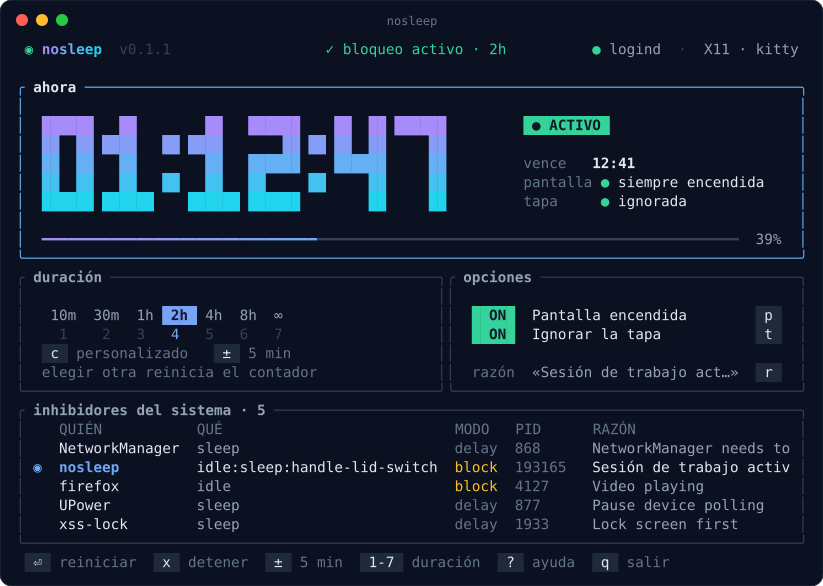
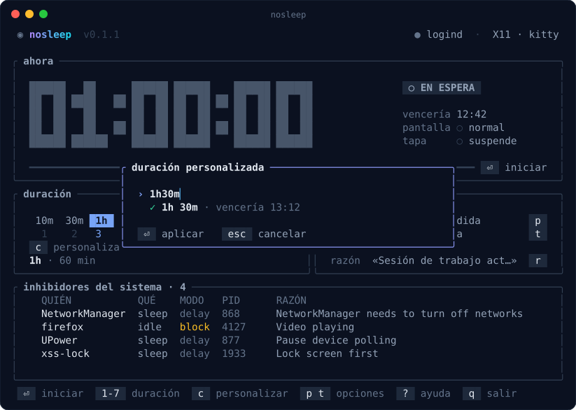

<div align="center">

# nosleep

**Mantén tu laptop Linux despierta. Sin dejar basura.**

Una app de terminal que mantiene un bloqueo de suspensión de `systemd-logind` el tiempo que
necesites, deja la pantalla encendida e ignora la tapa si se lo pides, y al terminar deja todo
como estaba.

[](https://crates.io/crates/nosleep-tui)
[](https://github.com/AngheloBR/nosleep-tui/actions/workflows/ci.yml)
[](#licencia)

Español · [English](README.md)



</div>

## Lo destacado

- **TUI interactiva.** Cuenta regresiva grande, barra de progreso, duraciones con una tecla,
  opciones que se cambian en vivo y la lista de todos los inhibidores del sistema en tiempo
  real. Ejecutas `nosleep` y listo.
- **CLI para scripts.** `nosleep -t 2h`, `nosleep --while cargo build`, `nosleep --list`.
- **El bloqueo nunca se queda colgado.** Vive en un descriptor de archivo: si el proceso muere,
  incluso con `SIGKILL`, el kernel lo cierra y logind lo suelta.
- **Pantalla encendida (X11).** Desactiva el salvapantallas y DPMS hablando directamente el
  protocolo X11 y luego devuelve exactamente tu configuración. No necesita `xset`.
- **Restauración a prueba de caídas.** La configuración de pantalla se guarda en disco *antes*
  de cambiar nada; tras una muerte forzada, `nosleep --restore` la recupera.
- **Un solo binario estático.** Sin Python, sin `libdbus`, sin `libX11`, sin dependencias.

## Instalación

### Binario precompilado (recomendado)

Descargas un archivo y ya. No necesitas Rust ni paquetes extra:

```sh
curl -fsSL https://github.com/AngheloBR/nosleep-tui/releases/latest/download/nosleep-x86_64-unknown-linux-musl.tar.gz \
  | tar xz --strip-components=1 -C ~/.local/bin nosleep-x86_64-unknown-linux-musl/nosleep
```

En ARM (Raspberry Pi, laptops ARM) usa `aarch64-unknown-linux-musl`.
Cada versión trae también su checksum `.sha256`.

### Fedora / RHEL / openSUSE (.rpm) · Debian / Ubuntu / Mint (.deb)

Descarga el paquete para tu sistema desde la
[última versión](https://github.com/AngheloBR/nosleep-tui/releases/latest) e instálalo con tu
gestor de paquetes:

```sh
sudo dnf install ./nosleep-tui-*.x86_64.rpm     # Fedora, RHEL
sudo apt install ./nosleep-tui_*_amd64.deb      # Debian, Ubuntu, Mint
```

El binario de dentro es estático, así que el mismo paquete funciona en versiones viejas y
nuevas, incluido Debian estable. Para desinstalar: `sudo dnf remove nosleep-tui` /
`sudo apt remove nosleep-tui`.

### Con Cargo (crates.io)

Si ya tienes Rust (1.88+):

```sh
cargo install nosleep-tui     # instala el comando `nosleep`
```

Para actualizar, repite el mismo comando; para desinstalar, `cargo uninstall nosleep-tui`.
Cargo deja el binario en `~/.cargo/bin`; si la terminal no encuentra `nosleep`, agrega esa
carpeta a tu `PATH`.

### Desde el código

Para tener los últimos cambios de `main` aún sin publicar:

```sh
cargo install --git https://github.com/AngheloBR/nosleep-tui
```

### Requisitos

- Linux con **systemd-logind** (Fedora, Ubuntu, Arch, Debian y casi todas).
- `--screen` / "pantalla encendida" además necesita una sesión **X11**.

## La TUI

Ejecuta `nosleep` sin argumentos.



| Tecla            | Acción                                   |
| ---------------- | ---------------------------------------- |
| `Enter` / `s`    | iniciar o reiniciar la cuenta            |
| `x`              | detener y restaurar todo                 |
| `+` / `-`        | sumar o restar 5 minutos                 |
| `1` … `7`        | 10m · 30m · 1h · 2h · 4h · 8h · ∞        |
| `c`              | duración personalizada con vista previa  |
| `p`              | mantener la pantalla encendida (X11)     |
| `t`              | ignorar el cierre de la tapa             |
| `r`              | cambiar la razón que ve logind           |
| `?`              | ayuda                                    |
| `q`              | salir (pregunta si hay un bloqueo activo)|

Si cambias opciones con el bloqueo activo se aplican al momento. El bloqueo nuevo se toma
*antes* de soltar el anterior, así que la laptop nunca queda desprotegida en el cambio.

Para abrir la TUI con valores ya puestos: `nosleep --tui -t 4h --screen`.

## La CLI

Con cualquier flag, `nosleep` funciona como un comando normal, útil para scripts:

```sh
nosleep -t 1h30m                # bloquea 1h30m, Ctrl+C para cortar antes
nosleep -t inf --screen --lid   # hasta Ctrl+C, pantalla encendida, tapa ignorada
nosleep --while cargo build --release   # solo mientras corre el comando; respeta su código de salida
nosleep --list                  # todos los inhibidores activos
nosleep --restore               # repara la pantalla tras una muerte forzada
```


### Duraciones

| Entrada           | Significado                    |
| ----------------- | ------------------------------ |
| `45s` `90m` `2h`  | segundos, minutos, horas       |
| `1d`              | días (máximo `365d`)           |
| `1h30m`           | combinadas                     |
| `90`              | número solo = minutos          |
| `1.5h` / `1,5h`   | decimales, con `.` o `,`       |
| `inf` / `0`       | sin límite de tiempo           |

### Opciones

| Opción            | Descripción                                               |
| ----------------- | --------------------------------------------------------- |
| `-t, --time DUR`  | Cuánto dura el bloqueo (por defecto `1h`)                 |
| `-s, --screen`    | Mantener la pantalla encendida (X11 / DPMS)               |
| `--lid`           | Inhibir también `handle-lid-switch`                       |
| `--reason TEXTO`  | Razón que verá logind y que aparece en `--list`           |
| `--while CMD...`  | Bloquear solo mientras corre `CMD`                        |
| `--tui`           | Abrir la TUI usando las opciones anteriores               |
| `--restore`       | Restaurar la pantalla tras una muerte forzada             |
| `--list`          | Listar los inhibidores activos                            |

## Cómo funciona

```
nosleep ──D-Bus──▶ org.freedesktop.login1.Manager.Inhibit("idle:sleep[:handle-lid-switch]", …, "block")
                     └─▶ devuelve un descriptor; el bloqueo dura mientras el fd siga abierto

pantalla:  lee salvapantallas + DPMS ──▶ $XDG_RUNTIME_DIR/nosleep/screen.json   (1. guardar)
           salvapantallas off · sin blanking · DPMS off  (protocolo X11, x11rb) (2. cambiar)
           al salir: restaura lo guardado y borra el archivo
```

Los bloqueos se sueltan en orden inverso (primero la pantalla, luego el inhibidor). Eso ocurre
al salir normalmente, con `q`, `Ctrl+C`, `SIGTERM`, `SIGHUP` y ante un panic.

## Limitaciones

- Mantener la pantalla encendida solo funciona en **X11**. En Wayland se niega en vez de fallar
  en silencio. El bloqueo de suspensión funciona en cualquier sesión.
- Sin `--lid` / `t`, cerrar la tapa sigue suspendiendo si tu configuración de logind lo indica.

## Desarrollo

```sh
cargo test
cargo clippy --all-targets
cargo test snapshots -- --ignored   # regenera las capturas de la TUI en docs/
```

Las capturas salen del mismo código que dibuja la TUI, así que siempre coinciden con la app.

## Licencia

Doble licencia [MIT](LICENSE-MIT) o [Apache-2.0](LICENSE-APACHE), a tu elección.
