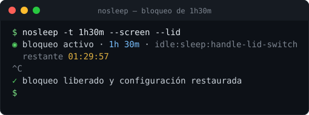
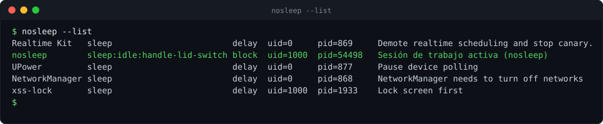

<div align="center">

# nosleep

**Keep your Linux laptop awake. Cleanly.**

A tiny Rust CLI that holds a `systemd-logind` inhibitor lock for as long as you need,
and can optionally keep the screen on and ignore the lid switch.

[Español](README.es.md) · English



</div>

## Why

`systemd-inhibit sleep 3600` works, but it doesn't show a countdown, it doesn't keep an X11
screen from blanking, and it can't put your display settings back if something goes wrong.
`nosleep` does all three:

- **logind inhibitor, held through a file descriptor.** When the process ends, even by
  `SIGKILL`, the kernel closes the fd and logind releases the lock. Nothing is left behind.
- **Screen stays on (`--screen`).** Turns off the X11 screensaver and DPMS through `xset`,
  and puts your exact previous values back when it exits.
- **Crash-safe restore.** Your original `xset` settings are written to disk *before* anything
  is changed. If the process is killed hard, `nosleep --restore` puts them back.
- **Tied to a command (`--while`).** Stays awake only while a build, backup or download runs,
  and passes on that command's exit code.

## Install

Requires Linux with **systemd-logind** and **Rust 1.88+**.
`--screen` also needs an **X11** session and `xset` (`sudo dnf install xset` / `sudo apt install x11-xserver-utils`).

```sh
cargo install --git https://github.com/AngheloBR/nosleep-tui
```

Or from a clone:

```sh
git clone https://github.com/AngheloBR/nosleep-tui
cd nosleep-tui
cargo install --path .
```

## Usage

```sh
nosleep                         # block sleep for 1 hour (default)
nosleep -t 1h30m                # custom duration
nosleep -t inf                  # until you press Ctrl+C
nosleep -t 8h --screen --lid    # screen on, closing the lid doesn't suspend
nosleep --while cargo build --release   # only while the command runs
nosleep --list                  # show every active inhibitor on the system
nosleep --restore               # repair screen settings after a hard kill
```

Press **Ctrl+C** at any time: the lock is released and your screen settings are restored.



### Durations

| Input             | Meaning                     |
| ----------------- | --------------------------- |
| `45s` `90m` `2h`  | seconds, minutes, hours     |
| `1d`              | days (maximum `365d`)       |
| `1h30m`           | combined                    |
| `90`              | bare number = minutes       |
| `1.5h` / `1,5h`   | decimals, with `.` or `,`   |
| `inf` / `0`       | no time limit               |

### Options

| Flag              | Description                                              |
| ----------------- | -------------------------------------------------------- |
| `-t, --time DUR`  | How long to hold the lock (default `1h`)                 |
| `-s, --screen`    | Keep the screen on (X11 / DPMS)                          |
| `--lid`           | Also inhibit `handle-lid-switch`                         |
| `--reason TEXT`   | Reason shown to logind and in `--list`                   |
| `--while CMD...`  | Hold the lock only while `CMD` runs                      |
| `--restore`       | Restore screen settings left behind by a hard kill       |
| `--list`          | List active inhibitors                                   |

## How it works

```
nosleep ──D-Bus──▶ org.freedesktop.login1.Manager.Inhibit("idle:sleep[:handle-lid-switch]", …, "block")
                     └─▶ returns a file descriptor; the lock lasts while that fd is open

--screen:  xset q ──▶ $XDG_RUNTIME_DIR/nosleep/xset.json   (1. save)
           xset s off · s noblank · -dpms                 (2. change)
           on exit (Drop): restore the saved values and delete the file
```

Locks are released in reverse order (screen first, then the inhibitor), and the release
works on normal exit, `Ctrl+C`, `SIGTERM`, `SIGHUP` and panics.

## Limitations

- `--screen` only works on **X11**. Under Wayland it refuses to run instead of failing
  silently. The sleep inhibitor works on any session.
- Closing the lid while `--lid` is not set will still suspend if your logind config says so.

## Development

```sh
cargo test
cargo clippy --all-targets
```

## License

Dual-licensed under **MIT OR Apache-2.0**, at your option.
